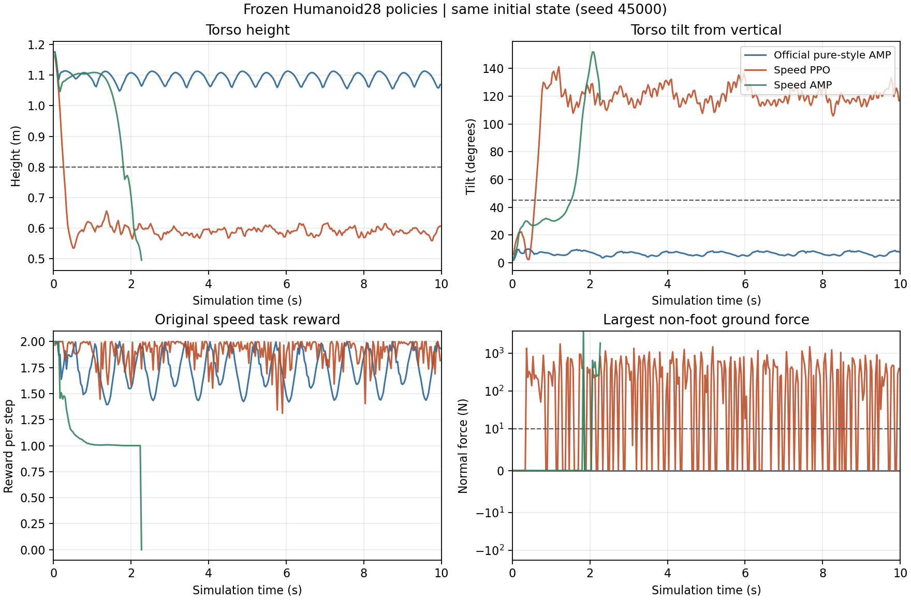

# R1 速度奖励漏洞诊断与公共任务修正

2026-11-25（韩国时间）

在原 1.5 m/s 任务中，低姿爬行可以拿到高速度奖励。冻结模型的回放显示，PPO 代表策略靠手和小腿支撑向前，AMP 速度策略倾向于低姿支撑。两者的直立行走验收均为 0/100。 [原始曲线、逐回合数据和实景回放](R1_speed_tracking_seed42.md)

## 冻结 checkpoint

本机 `artifacts/r1_reward_hacking/frozen_models/` 保存三个只读 checkpoint 和对应的环境、算法配置，原始文件仍在各自的训练目录。备份和原件的 SHA256 一致。原实验的评估、曲线与实景视频另存为本机归档，GitHub 上可按原提交 `2998bda` 找回。 [冻结项与校验清单](r1_reward_hacking/frozen_models.json)

## 同初态诊断

三个模型使用 Actor 均值和各自的归一化器，在官方 Humanoid28、同一 30 Hz 控制频率下回放。校准集为 45000–45009。接触使用 Isaac Lab ContactSensor 的 PhysX 法向力矩阵，过滤到场景中的地面碰撞 Plane。按连杆名区分双脚、双手、双小腿和其余连杆。小腿连杆的碰撞可以覆盖膝附近，力值按连杆归属。每个控制步取最后一个 60 Hz 物理子步的法向力。接触占比按任一对应连杆达到 10 N 的采样帧计算。

开启与关闭接触传感器时，三组各 10 个回合的初始观测、终止标志、控制步数、前进位移和逐步躯干速度全部一致。官方走路的双脚有地面载荷，校准集的非足端载荷为零。这个检查覆盖本轮轨迹和仿真设置。

| 冻结模型 | 跑满 / 直立行走 | 躯干高度中位数 (m) | 倾角中位数 | 手接触 | 小腿接触 | 其余非足端接触 |
|---|---:|---:|---:|---:|---:|---:|
| 官方纯风格 AMP 40.96M | 10 / 10 | 1.095 | 6.9° | 0% | 0% | 0% |
| 速度任务 PPO 40M | 10 / 0 | 0.590 | 121.2° | 37.3% | 45.6% | 0.03% |
| 速度任务 AMP 40M | 6 / 0 | 0.533 | 113.8° | 58.3% | 77.3% | 0.91% |

| 冻结模型 | 每步存活项 | 每步实得速度项 | 每步旧任务奖励 | 同一速度 AMP 判别器的风格奖励 |
|---|---:|---:|---:|---:|
| 官方纯风格 AMP 40.96M | 1.000 | 0.766 | 1.766 | 3.925 |
| 速度任务 PPO 40M | 1.000 | 0.871 | 1.871 | 0.104 |
| 速度任务 AMP 40M | 0.998 | 0.142 | 1.140 | 0.473 |

表中任务分项以旧速度任务统一重算。PPO 原训练的风格贡献为 0。官方纯风格 AMP 的任务权重为 0，速度任务 AMP 的任务与风格权重均为 1。回放风格值使用速度 AMP 最终 checkpoint 的同一判别器和归一化器，按 skrl 的 `-2 log(max(1 - sigmoid(logit), 0.0001))` 计算。表中采用 skrl 实际读取的 `info["amp_obs"]` 口径，自动重置前的风格值另行保存。原任务下，速度 PPO 和官方纯风格 AMP 在该组 10 个初态上均跑满。速度 AMP 有 4 个回合因原阈值 0.5 m 终止。

历史速度 AMP 的第 1–30 次更新中，平均每步任务奖励为 1.480，实得速度项为 0.516。到第 1201–1220 次更新，任务奖励为 1.117，其中存活项 0.998、实得速度项 0.119。历史日志保存了任务奖励分项和判别器损失，缺少逐更新的实际风格奖励。低姿支撑与主要赚取存活项的策略相符。同一个冻结判别器给官方直立轨迹更高风格分，现有证据不足以确认历史训练中的奖励冲突或证明局部最优成因。短训入口从 skrl 已执行的风格前向记录实际加权项和总和。

## 公共规则回放原型

两组沿用世界 +X 目标 1.5 m/s、速度尺度 0.5 m/s。每个有效步的原奖励公式为 `1 + exp(-0.5 * ((vx - 1.5) / 0.5)^2)`。有效步须同时满足躯干高度至少 0.80 m、倾角至多 45°、全部非足端连杆的地面法向力低于 10 N。无效步任务奖励为 0，连续 3 个无效控制步（0.10 秒）触发终止。原 0.5 m 跌倒条件继续即时生效。

官方 Walk 专家轨迹有 154 帧，躯干最低约 0.998 m，倾角最大约 7.7°。校准集内实际官方走路最低 1.009 m，最大倾角 14.7°。0.80 m 和 45° 给站姿波动留有余量。10 N 约为整机重力的 3%，正常回放的非足端力为零，低姿回放出现明显非足端载荷。规则通过门控既有任务奖励和增加终止实现。PPO 和 AMP 共用代码，AMP 的额外风格奖励沿用原设置。

| 验证集 45010–45029 | 原规则跑满 | 新规则跑满 | 新增条件终止 | 新规则存活中位数 |
|---|---:|---:|---:|---:|
| 官方纯风格 AMP | 20/20 | 20/20 | 0/20 | 9.97 s |
| 速度 PPO | 19/20 | 0/20 | 20/20 | 0.33 s |
| 速度 AMP | 16/20 | 0/20 | 20/20 | 1.23 s |

官方策略的 20 个轨迹逐回合复现，其中 18 个满足既有直立行走判据。PPO 有 4 个回合在新增终止帧上只触发非足端接触条件。修正规则验证范围为冻结策略的推理。 [逐回合数据与汇总](r1_reward_hacking/summary.json)

## R1 归档

R1 状态为 `COMPLETE_WITH_LIMITATIONS`。官方纯风格 AMP 完成基础复现。速度对照提供了任务奖励漏洞和动作品质变化的证据，公平直立行走的算法优势仍缺证据。项目以 R2 的 G1 单技能 AMP 为下一阶段。

256 环境下的 AMP 诊断试跑在 GPU 共享期间采到最低空闲显存 143 MiB，于 89 次更新记录后中止。原始试跑日志和 checkpoint 留在本机，PPO 配对和后续等待任务已取消。seed43、44 复验已取消。 [试跑记录](r1_reward_hacking/partial_run.json)
