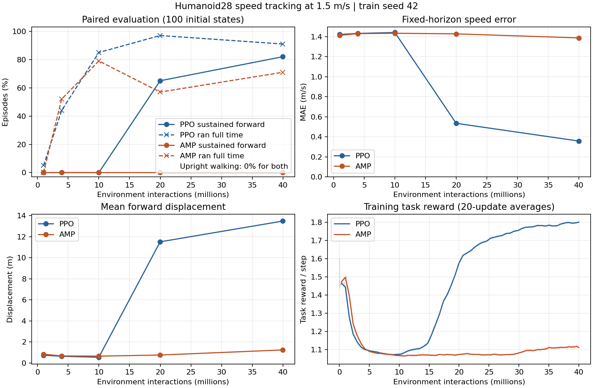

# R1 Humanoid28 速度跟踪 PPO/AMP 单种子对照

2026-11-25（韩国时间）

在共享的 1.5 m/s 任务上，PPO 比 AMP 更早学会持续前进，约 40M 步时的速度误差也更小。实景显示代表性 PPO 回合采用低姿爬行。两组在所有阶段均未出现跑满窗口的直立行走。

## 容量与资源

在 RTX 3070 8 GiB 上使用速度奖励入口测试 AMP。每档运行 20 次更新，整卡显存和利用率每 500 ms 采样。吞吐用实际交互步数除以端到端耗时，计入启动、训练、checkpoint 写入和退出。

| 并行环境 | 交互步 | 耗时 (s) | 交互步/s | 整卡峰值 (MiB) | 最低空闲 (MiB) | 峰值利用率 |
|---:|---:|---:|---:|---:|---:|---:|
| 256 | 81,920 | 19.60 | 4,179 | 4,742 | 3,091 | 64% |
| 512 | 163,840 | 22.40 | 7,315 | 4,982 | 2,851 | 94% |
| 1024 | 327,680 | 24.56 | 13,343 | 5,312 | 2,520 | 98% |
| 2048 | 655,360 | 28.70 | 22,835 | 5,781 | 2,052 | 99% |

四档均正常退出，训练采样指标有限。2048 档吞吐最高，两组使用该并行度。此前 2 环境 smoke 启动时整卡已经占用 3,736 MiB，容量测试启动时约为 1,045–1,080 MiB。排查时另一个 Isaac Sim 进程占用约 2,671 MiB，量级与基线差额吻合。该进程结束后才采到本表数据。原 smoke 的显存峰值来自整卡采样，进程级峰值分摊无同期记录。

| 组别 | 实际交互步 | 耗时 (s) | 交互步/s | 整卡峰值 (MiB) | 最低空闲 (MiB) | 平均 GPU 利用率 |
|---|---:|---:|---:|---:|---:|---:|
| PPO | 40,009,728 | 660.83 | 60,545 | 5,239 | 2,594 | 60.2% |
| AMP | 40,009,728 | 843.53 | 47,431 | 7,832 | 0 | 69.5% |

AMP 端到端耗时多 182.71 秒，约 28%。其长跑显存采样有 56 点低于 100 MiB 空闲，集中在约 28 秒内。进程快照采于运行前后，训练期间峰值的进程构成无法由快照确定。两组退出码均为 0，训练日志没有 OOM 或非有限值记录。十份阶段 checkpoint 的网络与归一化器参数均有限，优化器步数与更新次数相符。AMP 额外更新判别器，原始 TensorBoard 标量和整卡显存采样均随报告归档。

## 训练与评估设置

使用 Isaac Sim 4.5.0、Isaac Lab v2.1.1（`90b79bb`）、skrl 1.4.3。两个算法均从随机初始化出发，训练 seed42。保存的环境配置逐字节相同，Actor/Critic 配置和公共优化超参数一致。目标为世界 +X 的 1.5 m/s。AMP 叠加官方风格奖励，任务与风格权重均为 1。算法各用 skrl 自带实现，截断时的价值引导和 AMP 的额外采样等实现细节也计入这次对照。

两组各完成 1221 次更新。每次有 32,768 个交互步和 2 个 minibatch。每 5 次更新保存一次 checkpoint，约 40M 的最后一个可用 checkpoint 在第 1220 次更新，评估交互量为 39,976,960 步。

每个 checkpoint 使用相同的 100 个固定初态（seed 42000–42099）和确定性 Actor 均值动作。跑满约 10 秒对应 299 个控制步。10 回合初评后定义的持续前进要求每秒平均前进速度至少为 0.75 m/s，且前后半程各有至少两个正向交替足端事件。实景回放发现低姿爬行也能通过该判据。直立行走的复核加入最后一帧躯干高度至少 0.80 m 的必要条件，以及逐步的躯干倾角、手和小腿高度检查。固定窗口速度 MAE 将提前终止后的速度计为零。 [指标、训练预算与初态协议](R1_speed_tracking_comparison_protocol.md)

## 样本效率和任务表现

PPO 从约 20M 步开始出现持续前进，约 40M 步达到 82/100。AMP 曾在约 10M 步跑满 79/100，持续前进为 0/100。五个阶段内，两组所有跑满回合的终止躯干高度都低于 0.66 m。按修订判据，两组直立行走均为 0/100。

| checkpoint 交互步 | PPO 跑满 / 持续前进 | AMP 跑满 / 持续前进 | PPO 前进 (m) | AMP 前进 (m) | PPO 固定窗口 MAE (m/s) | AMP 固定窗口 MAE (m/s) |
|---:|---:|---:|---:|---:|---:|---:|
| 983,040 | 5 / 0 | 0 / 0 | 0.74 | 0.83 | 1.421 | 1.412 |
| 3,932,160 | 44 / 0 | 52 / 0 | 0.64 | 0.67 | 1.432 | 1.430 |
| 9,994,240 | 85 / 0 | 79 / 0 | 0.54 | 0.65 | 1.442 | 1.434 |
| 19,988,480 | 97 / 65 | 57 / 0 | 11.51 | 0.75 | 0.535 | 1.428 |
| 39,976,960 | 91 / 82 | 71 / 0 | 13.48 | 1.24 | 0.358 | 1.387 |

各单元格的跑满和前进计数以 100 回合为分母。PPO 首次达到 50% 持续前进率的已测 checkpoint 在 19,988,480 步。两组的直立行走样本效率在本预算内均无法估计。AMP 和 PPO 首次达到 50% 跑满率分别为 3.93M 和 9.99M 步。当前官方终止阈值为 0.5 m，机器人可以在较低的姿态下跑满窗口。

约 40M 步时，PPO 触发跌倒终止 9/100，AMP 为 29/100，平均存活时间分别为 9.16 秒和 7.62 秒。两组都跑满的 66 个相同初态上，PPO 速度 MAE 为 0.221 m/s，AMP 为 1.386 m/s。PPO 和 AMP 的持续前进率 95% Wilson 区间分别为 73.3%–88.3% 和 0%–3.7%。两组直立行走率区间均为 0%–3.7%。区间描述固定 checkpoint 在评估初态上的结果。

## 独立运动评价

以下为约 40M 步 checkpoint 的跑满回合描述，含低姿爬行和低姿支撑。关节分布的 W1 距离使用真实关节状态，参照同一官方 Walk 片段。足端周期基准来自该片段内 4 个估计的交替步。

| 指标 | PPO 跑满回合 | AMP 跑满回合 | 专家参考 |
|---|---:|---:|---:|
| 关节角 W1 (rad) | 0.546 (n=91) | 0.527 (n=71) | — |
| 关节角速度 W1 (rad/s) | 1.390 (n=91) | 0.987 (n=71) | — |
| 异侧足端事件间 +X 距离 (m) | 0.403 (n=91) | 0.035 (n=64) | 0.794 |
| 异侧足端事件频率 (次/min) | 218.5 (n=91) | 158.0 (n=64) | 116.1 |
| 左右足端事件间距相对差异 | 0.630 (n=90) | 1.679 (n=40) | 0.125 |
| 左右腿关节活动范围相对差异 | 0.418 (n=91) | 0.417 (n=71) | 0.217 |
| 左右腿关节速度 RMS 相对差异 | 0.360 (n=91) | 0.289 (n=71) | 0.232 |
| 相邻动作绝对变化均值 | 0.116 (n=91) | 0.069 (n=71) | — |

PPO 的 82 个持续前进回合中，足端事件间距平均为 0.412 m，频率约为 219.9 次/min。代表回放显示用手和膝附近贴地前进。AMP 则多为低姿支撑，步距和位移都很小。关节角速度 W1 较低也可能来自关节运动幅度较小。两组直立行走样本为空，直立步态的风格对照缺少同类样本。近地足端水平速度与覆盖率随原始数据保存，真实触地滑移需要独立的接触测量。

## 实景回放

回放均使用约 40M 步 checkpoint。四个案例的初始观测哈希和终止类型与原评估一致。PPO 跌倒案例在单独渲染时于第 55 步终止，原批次为第 53 步。同初态 42000 的两段跑满回放与原始结果的前进距离和终止高度一致。 [回放记录及文件哈希](r1_speed_tracking_seed42/video_cases.json)

| 回放 | 初态 seed | 表现 |
|---|---:|---|
| [PPO 低姿前进](r1_speed_tracking_seed42/ppo_low_forward.mp4) | 42000 | 跑满约 10 秒，前进 14.99 m |
| [AMP 低姿支撑](r1_speed_tracking_seed42/amp_low_support.mp4) | 42000 | 同一初态，跑满约 10 秒，前进 1.35 m |
| [PPO 高度触发终止](r1_speed_tracking_seed42/ppo_torso_height_termination.mp4) | 42008 | 躯干低于 0.5 m |
| [AMP 高度触发终止](r1_speed_tracking_seed42/amp_torso_height_termination.mp4) | 42002 | 躯干低于 0.5 m |

在约 40M 的两个速度任务 checkpoint 上，各用 42000–42009 复跑并采集逐步姿态。seed 42000 的 PPO 回合中，手 link 低于 0.20 m 的步占 91.3%，小腿 link 低于 0.18 m 的步占 97.3%。同一初态的 AMP 分别为 84.9% 和 88.3%。冻结的官方纯风格 40.96M checkpoint 在 45000–45009 的另 10 个初态上全部通过直立行走判据。 [姿态复核原始指标](r1_speed_tracking_seed42/posture_checks.json)

本轮支持比较 seed42 下的前向位移和速度误差。当前任务奖励和 0.5 m 终止阈值允许低姿策略累积相当多的任务奖励。直立步态主问题仍待解决，seed43、44 复验暂缓。

AMP 的判别器损失首末记录约为 2.785 和 1.004。学习曲线中的任务奖励取自相同环境奖励，运动评价使用策略轨迹和专家运动学。结论限定在 seed42 和这两个 skrl 训练设置，跨训练 seed 的复现仍待验证。

## 数据和复跑

- [汇总、checkpoint 路径与 SHA256](r1_speed_tracking_seed42/summary.json)
- [1,000 回合逐回合数据](r1_speed_tracking_seed42/episodes)，每档每算法一个 gzip 压缩的 JSON
- [每次更新的环境任务奖励和 TensorBoard 标量](r1_speed_tracking_seed42/training_curves.json.gz)
- 整卡 GPU 采样 [PPO](r1_speed_tracking_seed42/ppo_gpu.csv.gz) · [AMP](r1_speed_tracking_seed42/amp_gpu.csv.gz)
- 复跑入口 [容量](../scripts/r1_speed_tracking_capacity.sh) · [训练](../scripts/r1_speed_tracking_formal_seed42.sh) · [评估](../scripts/r1_speed_tracking_stage_eval.sh) · [汇总与作图](../scripts/r1_summarize_speed_tracking.py)

五档共 1,000 回合的初始观测哈希按 seed 对齐。PPO 约 10M 步的评估启动器中途退出，子进程仍写出了 100 回合原始结果，归档校验了 seed、checkpoint 哈希及完整输出。原始训练日志、场景配置和 checkpoint 保存在本机 `runs/` 与 `logs/skrl/` 下。
